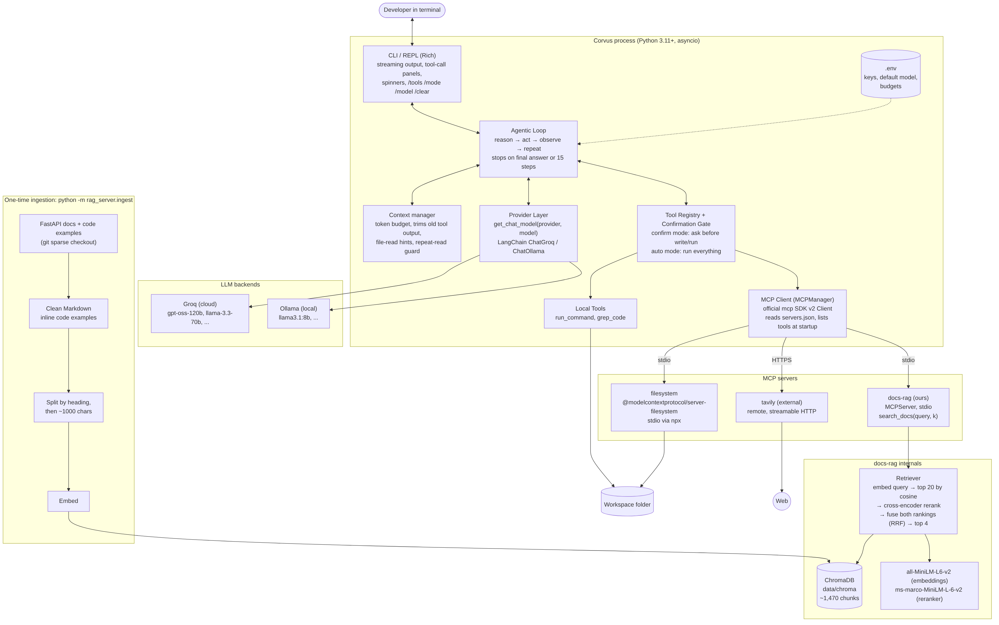
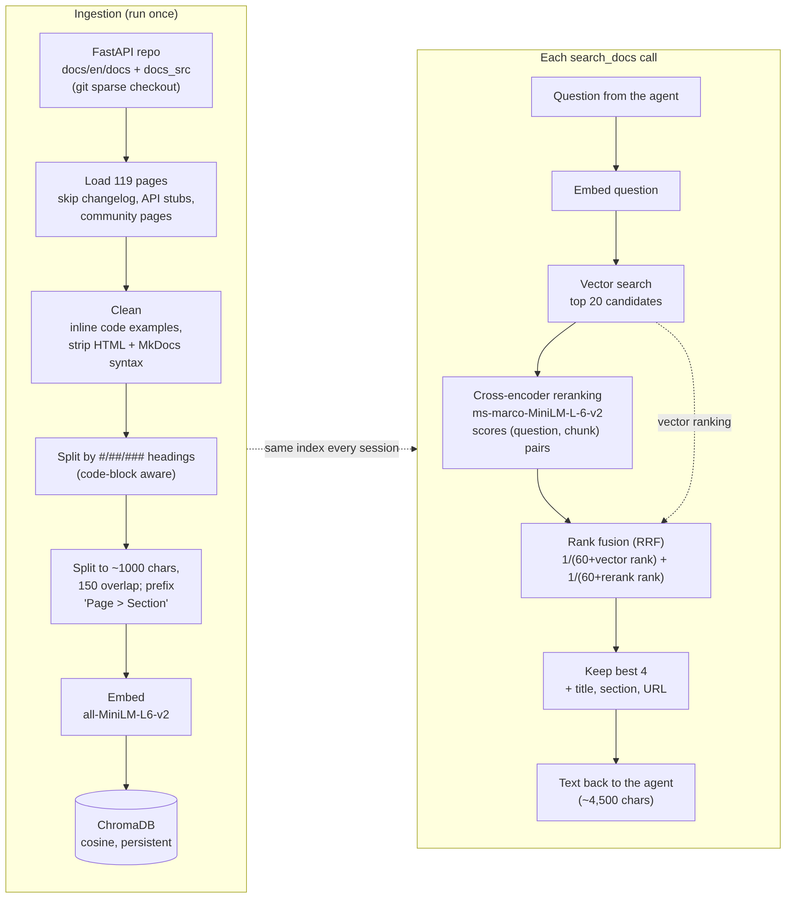
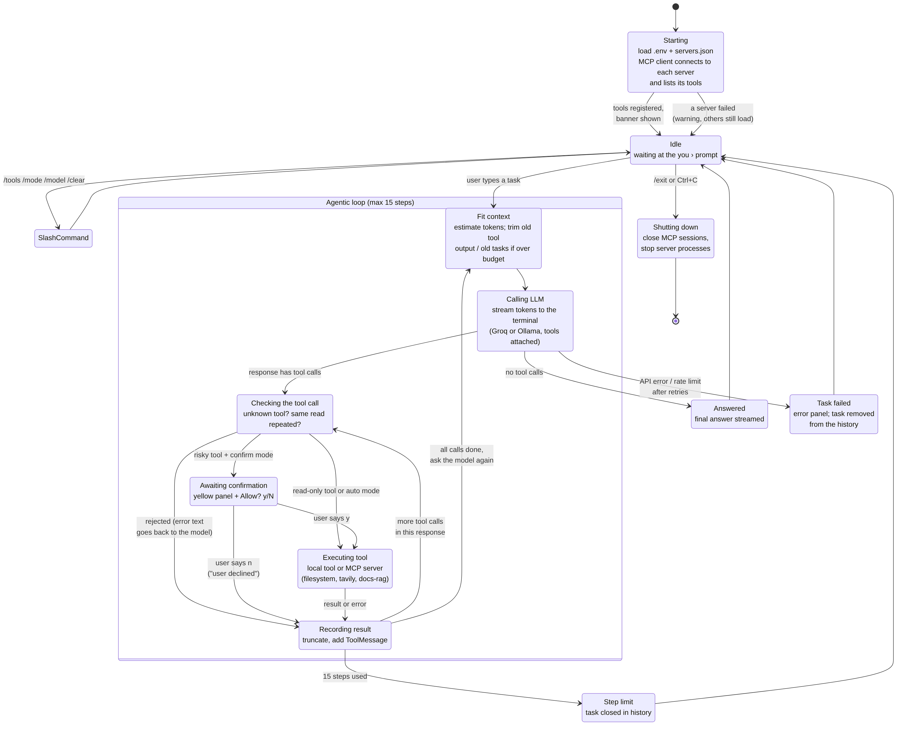
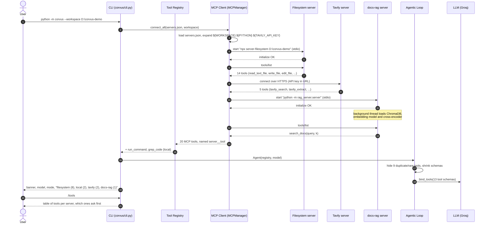
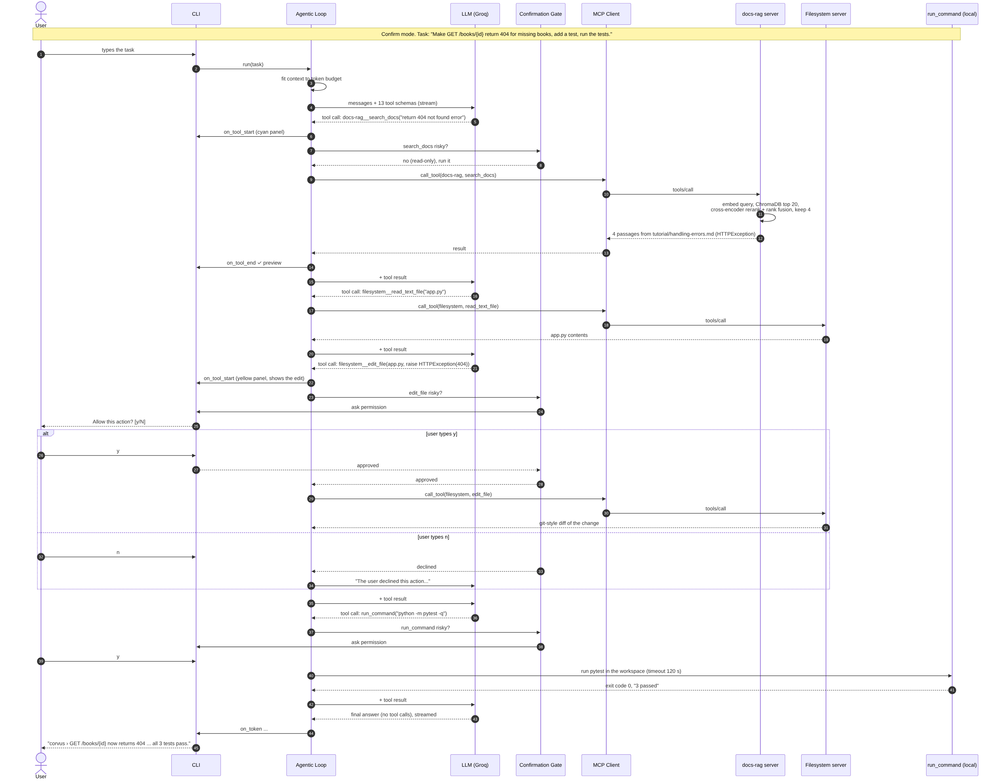
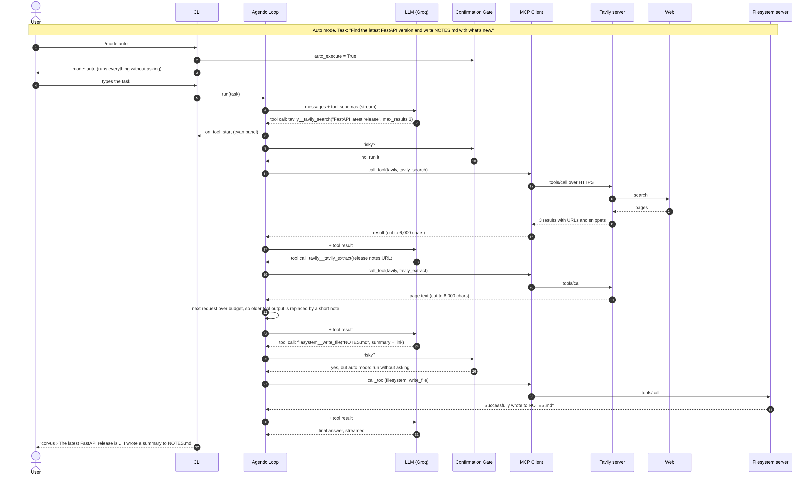

# Corvus: Final Architecture (v2)

This is the architecture as built. The original plan from Oct 1 is kept unchanged in [ARCHITECTURE.md](ARCHITECTURE.md) (tag `planning-v1`). The section [What changed since v1](#what-changed-since-v1-and-why) lists every difference and why we made it.

## Architecture diagram

Source: [`diagrams/architecture-v2.mmd`](diagrams/architecture-v2.mmd)

## Components

| Component | Code | What it does |
|---|---|---|
| CLI / REPL | `corvus/cli.py` | Rich-based terminal UI: banner, streamed answers, a panel per tool call (yellow when it needs approval), spinners, `/tools /mode /model /clear /exit` |
| Agentic loop | `corvus/agent.py` | Sends the conversation + tool schemas to the LLM, runs the tools it asks for, feeds results back, repeats until the model answers without tools or 15 steps pass |
| Context manager | `corvus/agent.py` (`_fit_context`, `_truncate_file_read`, read guard) | Keeps every request under a token budget so it fits Groq's free tier |
| Provider layer | `corvus/providers.py` | `get_chat_model(provider, model)` returns a LangChain chat model for Groq or Ollama; switchable at runtime |
| Tool registry + confirmation gate | `mcp_tools/registry.py`, `mcp_tools/confirmation.py` | One `execute()` for MCP and local tools; asks before risky tools in confirm mode; never raises, errors go back to the model |
| MCP client | `mcp_tools/manager.py`, `mcp_tools/config.py` | Starts/connects every server in `servers.json`, lists their tools at startup, names them `server__tool`, keeps going if one server fails |
| Local tools | `mcp_tools/local_tools.py` | `run_command` (shell, timeout kills the whole process tree) and `grep_code` |
| docs-rag server | `rag_server/` | Our MCP server: `search_docs(query, k)` over the FastAPI docs with reranking + rank fusion |
| Evaluation | `eval/` | RAG retrieval evaluation and LLM comparison with hidden grading tests |

## MCP servers

| Server | Transport | Tools Corvus shows the model |
|---|---|---|
| `filesystem` (`@modelcontextprotocol/server-filesystem`, official) | stdio via `npx`, sandboxed to the workspace | read_text_file, write_file, edit_file, list_directory, directory_tree, search_files, create_directory, move_file |
| `tavily` (external resource) | streamable HTTP to `mcp.tavily.com` | tavily_search, tavily_extract |
| `docs-rag` (ours) | stdio, `${PYTHON} -m rag_server.server` | search_docs |

The servers offer 20 tools in total. Corvus hides 9 that are duplicates or rarely useful (for example `read_file`, which is a deprecated alias, and `tavily_research`, which is slow and rate-limited), so each request carries 13 tool definitions instead of 22.

## Custom RAG server (docs-rag)

**Ingestion, run once with `python -m rag_server.ingest`:**
1. Git sparse checkout of `docs/en/docs` and `docs_src` from the FastAPI repo.
2. Load 119 pages. We skip the 700 KB changelog, the auto-generated API reference stubs, and community pages.
3. Clean each page. The docs pull their code examples in with `{* ../../docs_src/... *}` include lines, which we replace with the real code (cut at 60 lines). We also strip the HTML used for terminal colours and the MkDocs-only syntax.
4. Split the pages at `#`, `##` and `###` headings, then into ~1,000-character chunks with 150 characters of overlap. Each chunk starts with "Page > Section", so it still makes sense on its own.
5. Embed the chunks with `all-MiniLM-L6-v2`. That gives about 1,470 chunks, stored in a persistent ChromaDB collection (cosine distance) in `data/chroma`. Every later session reuses it.

**Query (advanced technique: Reranking, NirDiamant RAG_Techniques #17):**
1. Embed the question and fetch the 20 nearest chunks from ChromaDB.
2. Score each (question, chunk) pair with the cross-encoder `ms-marco-MiniLM-L-6-v2`. It reads both texts together, which makes it much better at judging whether a chunk actually answers the question.
3. Combine the vector ranking and the cross-encoder ranking with Reciprocal Rank Fusion (`1/(60 + vector rank) + 1/(60 + rerank rank)`) and return the best 4, with page title, section and link.

Step 3 came from our evaluation (`eval/rag_eval.py`, 25 questions). The cross-encoder alone fixed some vector-search mistakes, but it over-trusted literal word matches (for example "JSON" pulled in a JSON/Base64 page instead of the request-body tutorial). Fusion keeps a chunk on top only if both rankings agree:

| Method | Hit@1 | Hit@4 | MRR |
|---|---|---|---|
| Vector only | 76% | 92% | 0.830 |
| Rerank only | 80% | 88% | 0.830 |
| Rerank + fusion (used) | 80% | 92% | 0.850 |

The models load in a background thread when the server starts, so the first search isn't slow. `RAG_METHOD=vector|rerank|fusion` in `.env` switches the method.

## State diagram

How a session moves between states, and how information flows between the components.

Source: [`diagrams/state.mmd`](diagrams/state.mmd)

## Sequence diagrams

**1. Startup and dynamic tool discovery:** the MCP client starts three servers and lists their tools.

**2. Coding task in confirm mode:** a docs search (RAG server), a file read, a file edit that needs approval, then the tests run (also approved).

**3. Web research task in auto mode:** a Tavily search and page extraction, context trimming, then a file write that runs without asking.

Sources: [`sequence-startup.mmd`](diagrams/sequence-startup.mmd), [`sequence-coding-task.mmd`](diagrams/sequence-coding-task.mmd), [`sequence-web-task.mmd`](diagrams/sequence-web-task.mmd)

## Context management

Every model request re-sends the whole conversation plus every tool definition. Groq's free tier rejects any single request over 8,000 tokens and also caps tokens per minute and per day. We hit all three limits on Oct 8, so the loop now:

- **Estimates the size of every request** (4 characters ≈ 1 token, which over-estimates a little) and keeps it under a budget: 6,000 for Groq, 12,000 for Ollama.
- **Trims oldest-first when the budget is exceeded.** Old tool outputs are replaced with a one-line note first. If that isn't enough, whole earlier tasks are dropped. The current task is never touched.
- **Caps tool output:** 6,000 characters in general, 12,000 for file reads. When a file is cut, the note says exactly what to call next (*"call read_text_file with tail=119"*), because a vague "output was cut" note made the model retry the same read forever.
- **Blocks repeated reads:** the same read with the same arguments, or a third read of the same file in one task, is refused, unless something changed in between.
- **Recovers from provider errors by itself** (`Agent._recover`), found while comparing models: a tool call Groq rejects (invalid JSON, or not matching the schema) is asked for again; optional parameters accept `null`, and null arguments are dropped before the tool runs; an output-tokens-per-minute limit caps the reply length to that limit and waits for the next minute; a "request too large" shrinks the budget by a quarter and trims again; a tool call from a reply the provider marks as cut off (`finish_reason: length`) is not run, and the model is told to make smaller edits. At most three recoveries per model call; a daily-limit error is not retried. Each recovery is shown as a yellow note in the CLI.
- **Removes a failed task from the history,** so the next question isn't answered as if it were the old one. A task that hits the step limit is closed explicitly for the same reason.
- **Excludes heavy folders from `directory_tree`:** `venv`, `.git`, `node_modules` and `__pycache__`. One call on the project root used to return 33,000 lines.

## What changed since v1, and why

| Area | Planned (v1, Oct 1) | Built (v2) | Why |
|---|---|---|---|
| MCP client | `langchain-mcp-adapters` (`MultiServerMCPClient`) | Official `mcp` SDK v2 `Client`, wrapped in our `MCPManager` | Fewer dependencies and full control over tool naming (`server__tool`), pagination and error handling. LangChain still receives the schemas through `bind_tools`. |
| Tavily transport | Local `npx tavily-mcp` over stdio | Tavily's hosted MCP endpoint over HTTP | No extra local process; one less thing to break on Windows |
| Configuration | `config.yaml` + `.env` | `.env` only, read into a `Settings` dataclass | One place for keys and settings was enough |
| CLI | Rich + prompt_toolkit | Rich only | Rich's input was enough; one less dependency |
| Context management | "Truncate tool output" (one line in the risks table) | A full component: token budget, trimming, file-read hints, read guard, rollback, automatic recovery from provider errors | Real failures on Oct 8: 413 "request too large", a model re-reading a file in a loop until the step limit, and using up a day's token allowance. On Oct 14 the LLM comparison added schema-validation and output-token-limit errors |
| Tools shown to the model | All tools | 13 of 22, with descriptions shortened | Each tool definition is re-sent on every request; fewer tools means more room for the actual work |
| Step limit | 25 | 15 | A looping model burned most of a day's Groq allowance in two tasks |
| Confirmation gate | Tools tagged read-only/mutating, unknown tools default to mutating, `a` = always allow | Keyword match on the tool name (write, edit, move, run_command, ...), `y`/`N` only | Simpler and covers every tool we actually load. Using the MCP `readOnlyHint` annotations is the better long-term approach (see the report). |
| Robustness | Not planned | Code review fixes: one failing server no longer stops the others, a missing key for a disabled server doesn't crash startup, the tool registry never raises, timeouts kill child processes, `grep_code` works on a single file | Found by testing PR #1 before merging |
| RAG server framework | FastMCP | `MCPServer` | The MCP Python SDK v2 renamed FastMCP to MCPServer |
| Chunking | Split on headings, then ~800 chars | Our own code-aware heading splitter, code examples inlined, ~1,000 chars + 150 overlap, "Page > Section" prefix | LangChain's Markdown header splitter strips leading spaces from every line, which broke Python indentation in code examples. The docs also store most code in separate files. |
| Results per search | 5 | 4 (from 20 candidates) | Keeps a search result around 1,200 tokens, so it fits next to the tool definitions on Groq's free tier |
| Ranking | Cross-encoder score | Cross-encoder + vector ranking combined with Reciprocal Rank Fusion | Our evaluation: reranking alone gained top-1 accuracy but lost top-4 hits on literal word matches; fusion was best on all three metrics |
| servers.json | Fixed commands | `${WORKSPACE}`, `${PYTHON}`, `${PROJECT_ROOT}`, `${ENV_VAR}` and `cwd` | The RAG server must run with the venv's Python from the project folder, wherever Corvus was started |
| Default models | Groq + `qwen2.5-coder:7b` on Ollama | Groq `openai/gpt-oss-120b` (also compared with `gpt-oss-20b` and `qwen/qwen3.8-27b`); Ollama `llama3.1:8b` with a 16k context | Tool-calling reliability; Ollama's default context window is too small for 13 tool definitions |
| Evaluation | A question list for RAG | `eval/rag_eval.py` (Hit@1, Hit@4, MRR, Recall@20) and `eval/llm_compare.py` (same task, fresh workspace, hidden grading tests) | Repeatable numbers for the report |
